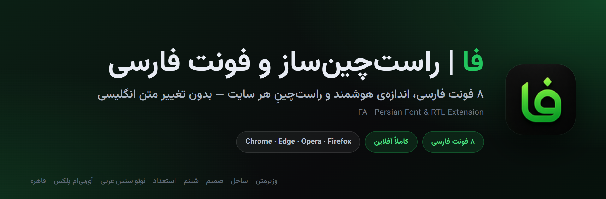
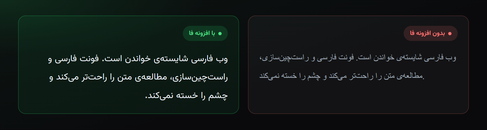
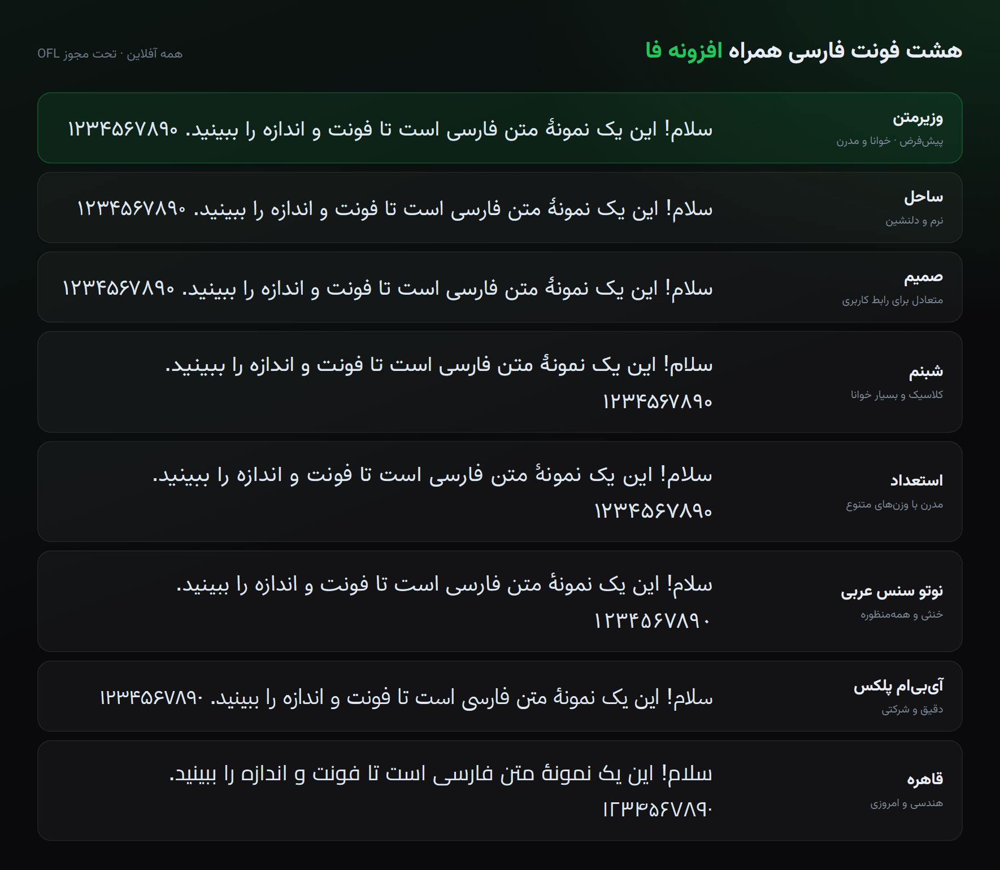

<div align="center">



<br>

**۸ فونت فارسی، اندازه‌ی هوشمند و راست‌چینِ هر سایت — بدون تغییر متن انگلیسی**

*8 Persian fonts, smart sizing and per-site RTL — without ever changing the site's English text.*

[](https://github.com/ArmanAZ44/FA_Persian_Extension/releases)

[](https://addons.mozilla.org/en-US/firefox/addon/fa_persian_extension/)

[](#en-install)


[](./LICENSE)


<br>

**🇮🇷 [فارسی](#persian)** &nbsp;·&nbsp; **🇬🇧 [English](#english)**

</div>

---

## 🖼️ پیش‌نمایش / Preview

<div align="center">



<br>



</div>

<details>
<summary><b>نمای پنل‌ها / Panel screenshots</b></summary>

<br>

<div align="center">


&nbsp;&nbsp;


<br><br>


</div>

</details>

---

<a id="persian"></a>

## 🇮🇷 فارسی

<table>
<tr><td>

**📑 فهرست**

- [✨ ویژگی‌ها](#fa-features)
- [🆕 تغییرات نسخه ۲.۰.۰](#fa-news)
- [🧭 سازگاری مرورگرها](#fa-browsers)
- [🚀 نصب](#fa-install)
- [⌨️ میانبرها](#fa-shortcuts)
- [🛠️ ساخت](#fa-build)
- [📁 ساختار پروژه](#fa-structure)
- [❓ پرسش‌های متداول](#fa-faq)
- [🤝 مشارکت و مجوز](#fa-license)

</td><td>

**🔗 پیوندهای سریع**

- [⬇ دریافت از Firefox Add-ons](https://addons.mozilla.org/en-US/firefox/addon/fa_persian_extension/)
- [⬇ بسته‌ی کروم / اج / اپرا](https://github.com/ArmanAZ44/FA_Persian_Extension/raw/main/dist/FA-v2.0.0-chrome.zip)
- [💬 تلگرام](https://t.me/ArmanAZPC)
- [❤️ حمایت](https://reymit.ir/armanaz44)

</td></tr>
</table>

<a id="fa-features"></a>

### ✨ ویژگی‌ها

| ویژگی                               | توضیح                                                                                                                                                                        |
| ----------------------------------- | ---------------------------------------------------------------------------------------------------------------------------------------------------------------------------- |
| 🔤 **فونت فارسی هوشمند**            | فونت انتخاب‌شده فقط روی بخش‌های فارسیِ متن اعمال می‌شود؛ **متن انگلیسی سایت هرگز تغییر نمی‌کند** (به لطف `unicode-range`).                                                    |
| 🎨 **۸ فونت فارسی همراه افزونه**    | وزیرمتن، ساحل، صمیم، شبنم، استعداد، نوتو سنس عربی، آی‌بی‌ام پلکس سنس عربی و قاهره — همه **آفلاین** و تحت مجوز OFL. هم از پاپ‌آپ (هر سایت) و هم از تنظیمات (سراسری) قابل تغییر. |
| 🅱 **ضخامت فونت**                   | نازک / معمولی / ضخیم / خودکار (ارث‌بری از خود سایت).                                                                                                                          |
| 📐 **اندازه‌ی هوشمند**              | اندازه‌ی فونت فارسی بر اساس نوع عنصر (تیتر، پاراگراف، دکمه، جدول و …) تنظیم می‌شود تا هماهنگ دیده شود.                                                                       |
| 📏 **فاصله‌ی خط و حروف**            | اسلایدر مستقل برای `line-height` و `letter-spacing` (پیش‌فرض: خودکار).                                                                                                       |
| ↔️ **راست‌چین هر سایت**             | راست‌چین پیش‌فرض خاموش است و برای هر سایت جداگانه از پاپ‌آپ روشن می‌شود.                                                                                                     |
| ✍️ **حین تایپ**                     | فونت و راست‌چین در فیلدهای فرم و ویرایشگرهای متنی (`contenteditable`) هم اعمال می‌شود — ویرایشگرهای کد استثنا هستند.                                                         |
| 📖 **دیکشنری هاور**                 | کلید `Alt` را نگه دارید و روی هر کلمه‌ی انگلیسی بروید تا معنی فارسی فوری ببینید — **کاملاً آفلاین**.                                                                         |
| 🔢 **ارقام فارسی**                  | تبدیل خودکار ارقام انگلیسی به فارسی داخل متن فارسی.                                                                                                                          |
| 🧹 **نرمال‌سازی «ي / ك» عربی**      | تبدیل حروف عربی به «ی / ک» فارسی برای یکدست‌شدن متن سایت‌ها.                                                                                                                  |
| ✒️ **اصلاح تایپوگرافی**             | افزودن نیم‌فاصله به «می‌»، «ها»، «تر» و اصلاح علائم فارسی.                                                                                                                   |
| 🌐 **ترجمه‌ی سریع**                 | ترجمه‌ی متن انتخاب‌شده با `Alt+Shift+T`.                                                                                                                                     |
| 👁️ **پیش‌نمایش زنده**               | هم در پاپ‌آپ و هم در تنظیمات، نتیجه‌ی فونت/اندازه/فاصله را همان لحظه ببینید — بدون بازکردن هیچ سایتی.                                                                       |
| ⚡ **پروفایل‌های آماده**             | «خوانا»، «فشرده»، «درشت» و «شیک» با یک کلیک چند تنظیم را با هم عوض می‌کنند.                                                                                                  |
| 🚫 **بیش از ۶۰٬۰۰۰ دامنه‌ی مستثنا** | همه‌ی دامنه‌های `.ir` و فهرستی گسترده از سایت‌های فارسی‌زبانِ غیر `.ir` خودکار مستثنا می‌شوند.                                                                               |
| ⚪ **حالت لیست سفید**                | می‌توانید افزونه را فقط روی سایت‌های انتخاب‌شده‌ی خودتان فعال کنید.                                                                                                          |
| 🧩 **حالت‌های سازگاری اختصاصی**     | مسیرهای ویژه و غیرتهاجمی برای **ChatGPT**، **Kick.com** و **YouTube**.                                                                                                       |
| 🎛️ **تنظیمات اختصاصی هر دامنه**    | برای هر سایت جداگانه فونت، راست‌چین، ضخامت، اندازه، ارقام و فاصله‌ها را تعیین کنید.                                                                                          |
| ⇅ **اعمال روی همه‌ی تب‌های باز**    | با یک کلیک، همه‌ی تب‌های بازخوانی می‌شوند.                                                                                                                                   |
| 💾 **پشتیبان‌گیری خودکار + JSON**   | تنظیمات خودکار پشتیبان‌گیری و هم‌گام می‌شوند؛ خروجی/ورودی JSON هم موجود است.                                                                                                |

<a id="fa-news"></a>

### 🆕 تغییرات نسخه ۲.۰.۰

- **🎬 رفع باگ انباشتگی عنوان ویدیوهای YouTube:** موتور عمومی متن‌ها را با `segmentTextNode` می‌شکست و این با رندر مجدد کامپوننت‌های Polymer/ytd یوتیوب تداخل داشت؛ نتیجه این بود که عنوان ویدیوها روی هم انباشته می‌شدند. حالا «حالت سازگاری مخصوص YouTube» هیچ ساختاری از DOM را تغییر نمی‌دهد.
- **🌐 پشتیبانی چندمرورگری:** یک منبع مشترک + `manifest.json` (کروم/اج/اپرا با `service_worker`) و `manifest.firefox.json` (فایرفاکس با `background.scripts`) و اسکریپت `build.js` برای تولید هر دو بسته.
- **🅰️ هشت فونت فارسی:** همراه بسته، آفلاین، تحت مجوز OFL، با انتخابگر فونت در پاپ‌آپ و تنظیمات.
- **⚡ ده قابلیت تازه:** پیش‌نمایش زنده، پروفایل‌های آماده، ضخامت فونت، اسلایدر فاصله‌ی خط و حروف، نرمال‌سازی «ي/ك»، حالت لیست سفید، پشتیبان‌گیری خودکار، اعمال روی همه‌ی تب‌ها، فاوآیکون و کپی دامنه.
- **🎨 رابط کاربری بازطراحی‌شده** با آیکون، اسلایدر رنگی و ظاهر شیشه‌ای.
- **📏 استانداردسازی مقیاس فونت به مبنای ۱۰۰** با حفظ دقیق اندازه‌ی رندر و مهاجرت خودکار کاربران قبلی.
- **🐞 رفع باگ‌ها:** جلوگیری از راست‌چین‌شدن کل صفحه، رفع حلقه‌ی بی‌پایان پشتیبان‌گیری، و رفع ناهماهنگی نشان آیکون.

<a id="fa-browsers"></a>

### 🧭 سازگاری مرورگرها

| مرورگر              | نسخه | وضعیت                                  |
| ------------------- | ---- | -------------------------------------- |
| Firefox             | ۱۴۰+ | ✅ [منتشر شده در Firefox Add-ons][amo]  |
| Firefox for Android | ۱۴۲+ | ✅ [منتشر شده در Firefox Add-ons][amo]  |
| Chrome              | ۱۰۹+ | ✅ پشتیبانی کامل                        |
| Edge                | ۱۰۹+ | ✅ پشتیبانی کامل                        |
| Opera               | ۹۵+  | ✅ پشتیبانی کامل                        |
| Chrome Web Store    | —    | ⏳ به‌زودی                              |

[amo]: https://addons.mozilla.org/en-US/firefox/addon/fa_persian_extension/

<a id="fa-install"></a>

### 🚀 نصب

**🦊 فایرفاکس (ساده‌ترین راه)**

**[⬇ دریافت از Firefox Add-ons](https://addons.mozilla.org/en-US/firefox/addon/fa_persian_extension/)** — روی **Add to Firefox** کلیک کنید. به‌روزرسانی‌های بعدی خودکار نصب می‌شوند.

**🌐 کروم / اج / اپرا**

> 🔜 به‌زودی در **Chrome Web Store**. تا آن زمان از نصب دستی استفاده کنید.

1. فایل [`dist/FA-v2.0.0-chrome.zip`](https://github.com/ArmanAZ44/FA_Persian_Extension/raw/main/dist/FA-v2.0.0-chrome.zip) را دانلود و از حالت فشرده خارج کنید.
2. به `chrome://extensions` (یا `edge://extensions` / `opera://extensions`) بروید.
3. **Developer mode** را روشن کنید و روی **Load unpacked** کلیک کنید.

**🦊 فایرفاکس — نصب دستی**

1. فایل `dist/FA-v2.0.0-firefox.xpi` را از حالت فشرده خارج کنید.
2. به `about:debugging#/runtime/this-firefox` بروید.
3. روی **Load Temporary Add-on...** کلیک کنید و `manifest.json` را انتخاب کنید.

<a id="fa-shortcuts"></a>

### ⌨️ میانبرها

| میانبر        | عملکرد                                          |
| ------------- | ----------------------------------------------- |
| `Alt+Shift+F` | روشن/خاموش کردن کلی افزونه                      |
| `Alt+Shift+S` | روشن/خاموش کردن راست‌چین در سایت جاری           |
| `Alt+Shift+T` | ترجمه‌ی سریع متن انتخاب‌شده (در صورت فعال بودن) |
| `Alt` + هاور  | نمایش معنی فارسی کلمه‌ی انگلیسی (دیکشنری هاور)  |

<a id="fa-build"></a>

### 🛠️ ساخت

نیازمندی: فقط **Node.js** — بدون هیچ وابستگی خارجی (ZIP با `zlib` داخلی Node ساخته می‌شود).

```bash
node build.js
```

```
dist/
├── FA-v2.0.0-chrome.zip    ← کروم / اج / اپرا
└── FA-v2.0.0-firefox.xpi   ← فایرفاکس
```

<a id="fa-structure"></a>

### 📁 ساختار پروژه

| مسیر                       | توضیح                                                                                        |
| -------------------------- | -------------------------------------------------------------------------------------------- |
| `content.js`               | موتور اصلی: فونت، اندازه‌ی هوشمند، راست‌چین، نرمال‌سازی ي/ك، دیکشنری هاور و حالت‌های سازگاری |
| `background.js`            | منوی راست‌کلیک، میانبرها، نشان آیکون، ترجمه، مهاجرت تنظیمات و پشتیبان‌گیری خودکار              |
| `exclusions.js`            | هسته‌ی متمرکز: پیش‌فرض‌ها، استثناها، **رجیستری فونت‌ها**، پروفایل‌های آماده و منطق تفکیک هر سایت |
| `excluded-domains-data.js` | فهرست ۶۰٬۰۰۰+ دامنه‌ی مستثنا (فقط داده)                                                       |
| `dictionary.js`            | دیکشنری آفلاین برای «دیکشنری هاور»                                                            |
| `popup.html/css/js`        | پاپ‌آپ: پیش‌نمایش زنده، انتخاب فونت، پروفایل‌ها و تنظیمات هر سایت                              |
| `options.html/css/js`      | صفحه‌ی تنظیمات پیشرفته (۴ تب)                                                                 |
| `panel-fonts.css`          | تعریف `@font-face` همه‌ی فونت‌های همراه، مشترک بین پاپ‌آپ و تنظیمات                            |
| `manifest.json`            | مانیفست کروم / اج / اپرا                                                                      |
| `manifest.firefox.json`    | مانیفست فایرفاکس                                                                              |
| `build.js`                 | ساخت بسته‌های آماده‌ی نصب هر مرورگر                                                            |
| `fonts/`                   | ۲۰ فایل woff2 — هشت فونت فارسی                                                                 |
| `assets/`                  | تصاویر مستندات                                                                                 |
| `STORE_LISTING.md`         | متن‌های آماده برای صفحه‌ی فروشگاه‌ها                                                            |

<a id="fa-faq"></a>

### ❓ پرسش‌های متداول

<details>
<summary><b>چرا فونت انگلیسی سایت‌ها تغییر نمی‌کند؟</b></summary>

فونت‌های فارسی با `unicode-range` محدود به بازه‌های یونیکد فارسی تعریف شده‌اند؛ یعنی مرورگر فقط برای گلیف‌های فارسی از آن‌ها استفاده می‌کند و بقیه‌ی کاراکترها با فونت اصلی سایت رندر می‌شوند.

</details>

<details>
<summary><b>فونت‌ها به اینترنت وصل می‌شوند؟</b></summary>

خیر. هر ۸ فونت به‌صورت فایل woff2 داخل خودِ بسته عرضه شده‌اند و هیچ درخواست اینترنتی‌ای برای بارگذاری فونت زده نمی‌شود.

</details>

<details>
<summary><b>حالت لیست سفید چطور کار می‌کند؟</b></summary>

در تب «سایت‌ها» گزینه‌ی «فقط روی سایت‌های انتخاب‌شده فعال باشد» را روشن کنید. از آن به بعد افزونه فقط روی سایت‌هایی کار می‌کند که خودتان فعالشان کرده باشید. دامنه‌های `.ir` همچنان کاملاً مستثنا می‌مانند.

</details>

<details>
<summary><b>عدد ۱۰۰ در «اندازه فونت» یعنی چه؟</b></summary>

از نسخه ۲.۰.۰، عدد ۱۰۰ مبنای استاندارد است و دقیقاً معادل همان ۱۱۵٪ نسخه‌های ۱.x است. یعنی با ارتقا، اندازه‌ی فونت شما تغییری نمی‌کند.

</details>

<details>
<summary><b>افزونه داده‌ای از من جمع می‌کند؟</b></summary>

خیر. همه‌چیز محلی است. تنها ویژگی متصل به اینترنت «ترجمه‌ی سریع» است که پیش‌فرض خاموش است. در صفحه‌ی فروشگاه Mozilla هم «Data collection: none» اعلام شده است.

</details>

<a id="fa-license"></a>

### 🤝 مشارکت و مجوز

از مشارکت استقبال می‌شود: پروژه را Fork کنید، شاخه بسازید، تغییرات را کامیت کنید و یک **Pull Request** باز کنید. پیش از ارسال، خروجی `node build.js` را بررسی کنید.

این پروژه تحت مجوز **MIT** منتشر شده است — فایل [LICENSE](./LICENSE). فونت‌های همراه تحت **SIL OFL** هستند.

---

<a id="english"></a>

## 🇬🇧 English

<table>
<tr><td>

**📑 Contents**

- [✨ Features](#en-features)
- [🆕 What's new in 2.0.0](#en-news)
- [🧭 Browser support](#en-browsers)
- [🚀 Install](#en-install)
- [⌨️ Shortcuts](#en-shortcuts)
- [🛠️ Build](#en-build)
- [📁 Project structure](#en-structure)
- [❓ FAQ](#en-faq)
- [🤝 Contributing & License](#en-license)

</td><td>

**🔗 Quick links**

- [⬇ Get it on Firefox Add-ons](https://addons.mozilla.org/en-US/firefox/addon/fa_persian_extension/)
- [⬇ Chrome / Edge / Opera package](https://github.com/ArmanAZ44/FA_Persian_Extension/raw/main/dist/FA-v2.0.0-chrome.zip)
- [💬 Telegram](https://t.me/ArmanAZPC)
- [❤️ Support](https://reymit.ir/armanaz44)

</td></tr>
</table>

<a id="en-features"></a>

### ✨ Features

| Feature                             | Description                                                                                                                                                                            |
| ----------------------------------- | -------------------------------------------------------------------------------------------------------------------------------------------------------------------------------------- |
| 🔤 **Smart Persian font**           | The chosen font is applied only to the Persian parts of the text — the site's **English text is never changed** (thanks to `unicode-range`).                                           |
| 🎨 **8 bundled Persian fonts**      | Vazirmatn, Sahel, Samim, Shabnam, Estedad, Noto Sans Arabic, IBM Plex Sans Arabic and Cairo — all **offline** and **OFL**-licensed. Switchable per site (popup) and globally (options). |
| 🅱 **Font weight**                  | Light / normal / bold / auto (inherit from the site).                                                                                                                                  |
| 📐 **Smart sizing**                 | Persian font size is tuned per element type (heading, paragraph, button, table, …) for visual balance.                                                                                  |
| 📏 **Line-height & letter-spacing** | Independent sliders for both (default: auto).                                                                                                                                          |
| ↔️ **Per-site RTL**                 | Off by default; enabled per website from the popup.                                                                                                                                    |
| ✍️ **While typing**                 | Font and RTL also apply inside form fields and rich-text editors — code editors are excluded.                                                                                           |
| 📖 **Hover dictionary**             | Hold `Alt` and hover any English word for an instant Persian meaning — **fully offline**.                                                                                              |
| 🔢 **Persian digits**               | Automatic conversion of English digits inside Persian text.                                                                                                                             |
| 🧹 **Arabic yeh/kaf normalization** | Converts `ي / ك` to `ی / ک`.                                                                                                                                                            |
| ✒️ **Typography fixes**             | Adds the Persian zero-width non-joiner to «می», «ها», «تر» and fixes punctuation.                                                                                                      |
| 🌐 **Quick translate**              | Translate the selected text with `Alt+Shift+T`.                                                                                                                                         |
| 👁️ **Live preview**                 | See the result of font/size/spacing instantly, in the popup and in the options page.                                                                                                    |
| ⚡ **Presets**                       | Readable / Compact / Large / Elegant — one click each.                                                                                                                                  |
| 🚫 **60,000+ excluded domains**     | Every `.ir` domain plus a large curated list of Persian-language sites on other TLDs.                                                                                                   |
| ⚪ **Whitelist mode**                | Run the extension only on the sites you choose.                                                                                                                                         |
| 🧩 **Compatibility modes**          | Non-invasive paths for **ChatGPT**, **Kick.com** and **YouTube**.                                                                                                                       |
| 🎛️ **Per-domain overrides**         | Set font, RTL, weight, size, digits and spacing per website.                                                                                                                            |
| ⇅ **Apply to all open tabs**        | Reload every open tab with one click.                                                                                                                                                   |
| 💾 **Auto-backup + JSON**           | Settings are backed up and synced automatically; JSON export/import is also available.                                                                                                  |

<a id="en-news"></a>

### 🆕 What's new in 2.0.0

- **🎬 Fixed the YouTube title accumulation bug:** the general engine split text nodes with `segmentTextNode`, which conflicted with how YouTube's Polymer/ytd components re-render — video titles stacked on top of each other. The dedicated YouTube compatibility mode now never mutates the DOM structure.
- **🌐 Cross-browser support:** one shared source with `manifest.json` (Chrome/Edge/Opera, `service_worker`) and `manifest.firefox.json` (Firefox, `background.scripts`), plus a `build.js` that produces both packages.
- **🅰️ Eight Persian fonts** bundled offline under the OFL, with a font picker in the popup and options.
- **⚡ Ten new capabilities:** live preview, presets, font weight, line-height/letter-spacing sliders, Arabic yeh/kaf normalization, whitelist mode, auto-backup, apply-to-all-tabs, favicon and domain copy.
- **🎨 Redesigned UI** with icons, filled sliders and a glassmorphism look.
- **📏 Font scale standardized to a 100 basis** while keeping the rendered size identical, with automatic migration for existing users.
- **🐞 Bug fixes:** prevented whole-page RTL flips, fixed an infinite auto-backup loop, and fixed the badge mismatch.

<a id="en-browsers"></a>

### 🧭 Browser support

| Browser             | Version | Status                                 |
| ------------------- | ------- | -------------------------------------- |
| Firefox             | 140+    | ✅ [Published on Firefox Add-ons][amo]  |
| Firefox for Android | 142+    | ✅ [Published on Firefox Add-ons][amo]  |
| Chrome              | 109+    | ✅ Fully supported                      |
| Edge                | 109+    | ✅ Fully supported                      |
| Opera               | 95+     | ✅ Fully supported                      |
| Chrome Web Store    | —       | ⏳ Coming soon                          |

<a id="en-install"></a>

### 🚀 Install

**🦊 Firefox (easiest)**

**[⬇ Get it on Firefox Add-ons](https://addons.mozilla.org/en-US/firefox/addon/fa_persian_extension/)** — click **Add to Firefox**. Future updates install automatically.

**🌐 Chrome / Edge / Opera**

> 🔜 Coming soon to the **Chrome Web Store**. Until then, install manually.

1. Download and unzip [`dist/FA-v2.0.0-chrome.zip`](https://github.com/ArmanAZ44/FA_Persian_Extension/raw/main/dist/FA-v2.0.0-chrome.zip).
2. Open `chrome://extensions` (or `edge://extensions` / `opera://extensions`).
3. Enable **Developer mode** and click **Load unpacked**.

**🦊 Firefox — manual install**

1. Unzip `dist/FA-v2.0.0-firefox.xpi`.
2. Open `about:debugging#/runtime/this-firefox`.
3. Click **Load Temporary Add-on...** and select `manifest.json`.

<a id="en-shortcuts"></a>

### ⌨️ Shortcuts

| Shortcut      | Action                                         |
| ------------- | ---------------------------------------------- |
| `Alt+Shift+F` | Toggle the whole extension                     |
| `Alt+Shift+S` | Toggle RTL on the current site                 |
| `Alt+Shift+T` | Quick-translate the selected text (if enabled) |
| `Alt` + hover | Show the Persian meaning of an English word    |

<a id="en-build"></a>

### 🛠️ Build

Requires only **Node.js** — no external dependencies (the ZIP writer uses Node's built-in `zlib`).

```bash
node build.js
```

```
dist/
├── FA-v2.0.0-chrome.zip    ← Chrome / Edge / Opera
└── FA-v2.0.0-firefox.xpi   ← Firefox
```

<a id="en-structure"></a>

### 📁 Project structure

| Path                       | Description                                                                                           |
| -------------------------- | ----------------------------------------------------------------------------------------------------- |
| `content.js`               | Core engine: font, smart sizing, RTL, yeh/kaf normalization, hover dictionary and compatibility modes |
| `background.js`            | Context menus, shortcuts, badge, translation, settings migration and auto-backup                       |
| `exclusions.js`            | Central core: defaults, exclusions, **font registry**, presets and per-site resolution                  |
| `excluded-domains-data.js` | The 60,000+ excluded domain list (data only)                                                            |
| `dictionary.js`            | Offline dictionary for the hover feature                                                                |
| `popup.html/css/js`        | Popup: live preview, font picker, presets and per-site settings                                         |
| `options.html/css/js`      | Advanced settings page (4 tabs)                                                                         |
| `panel-fonts.css`          | `@font-face` declarations for all bundled fonts, shared by both panels                                  |
| `manifest.json`            | Chrome / Edge / Opera manifest                                                                          |
| `manifest.firefox.json`    | Firefox manifest                                                                                        |
| `build.js`                 | Builds ready-to-install packages for every browser                                                      |
| `fonts/`                   | 20 woff2 files — eight Persian fonts                                                                    |
| `assets/`                  | Documentation images                                                                                    |
| `STORE_LISTING.md`         | Ready-to-paste store listing copy                                                                       |

<a id="en-faq"></a>

### ❓ FAQ

<details>
<summary><b>Why is the site's English text never changed?</b></summary>

The Persian fonts are declared with a `unicode-range` limited to Persian Unicode blocks, so the browser only uses them for Persian glyphs; every other character keeps the site's original font.

</details>

<details>
<summary><b>Do the fonts require an internet connection?</b></summary>

No. All eight fonts ship as woff2 files inside the package, and no network request is ever made to load a font.

</details>

<details>
<summary><b>How does whitelist mode work?</b></summary>

Enable “Only run on selected sites” in the Sites tab. From then on the extension only works on sites you have explicitly enabled. `.ir` domains remain fully excluded.

</details>

<details>
<summary><b>What does 100 mean in “font size”?</b></summary>

Since 2.0.0, 100 is the standard basis and is exactly equivalent to the previous 115% from the 1.x releases — upgrading does not change your rendered font size.

</details>

<details>
<summary><b>Does the extension collect any data?</b></summary>

No. Everything runs locally. The only network feature is the optional quick-translate (off by default). The Mozilla listing also declares “Data collection: none”.

</details>

<a id="en-license"></a>

### 🤝 Contributing & License

Contributions are welcome: fork the project, create a branch, commit your changes and open a **Pull Request**. Please run `node build.js` before submitting.

Released under the **MIT License** — see [LICENSE](./LICENSE). The bundled fonts are licensed under the **SIL OFL**.

---

<div align="center">

**ساخته‌شده با ♥ برای وب فارسی** — Made with ♥ for the Persian web

اگر این افزونه برایتان مفید بود، یک ⭐ به مخزن بدهید · If you find it useful, please star the repo.

</div>
