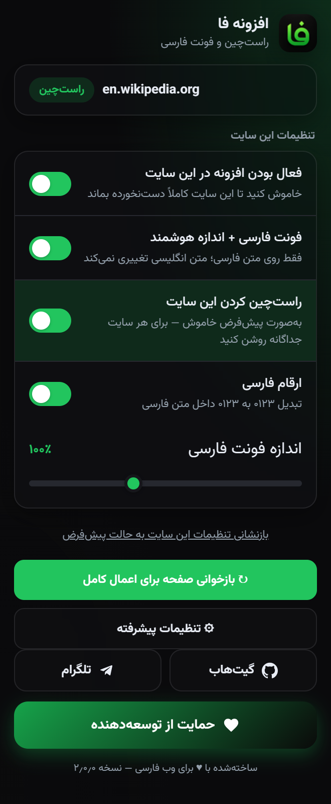
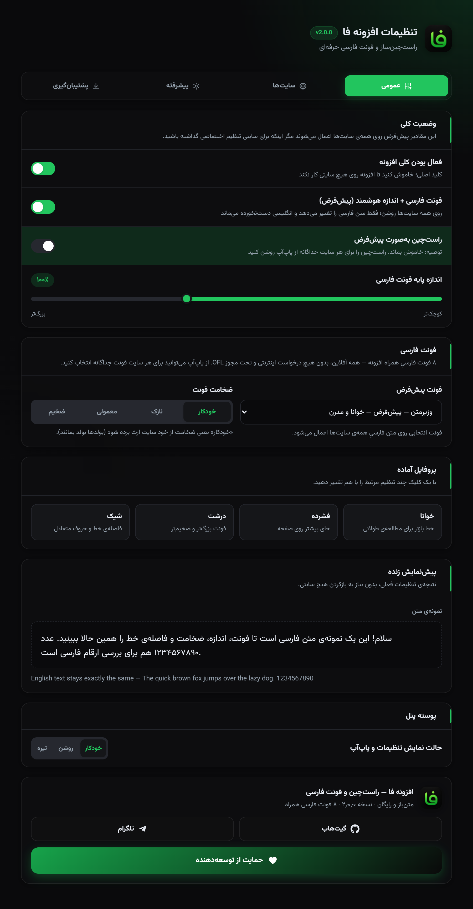
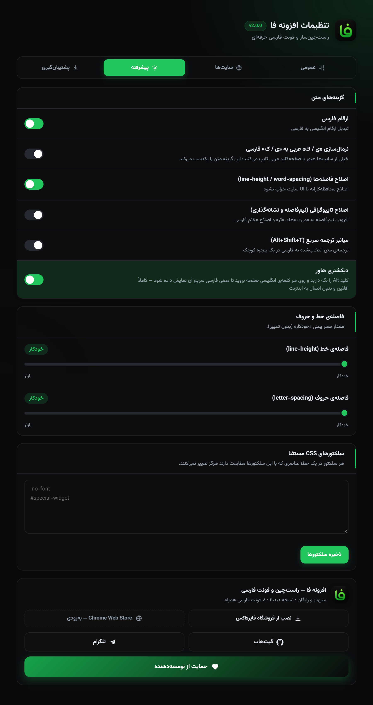

<div align="center">

# فا | راست‌چین‌ساز و فونت فارسی
### FA | Persian Font & RTL Extension

افزونه‌ی چندمرورگری (Manifest V3) برای اعمال فونت فارسی **وزیرمتن**، اندازه‌ی هوشمند، و راست‌چینِ اختیاریِ هر سایت روی متن صفحات وب.

A cross‑browser Manifest V3 extension that applies the **Vazirmatn** Persian font, smart per‑element sizing, and optional per‑site RTL to web page text.

**کروم / Chrome · اج / Edge · اپرا / Opera · فایرفاکس / Firefox**

[](https://github.com/ArmanAZ44/FA_Persian_Extension)
[](https://t.me/ArmanAZPC)


</div>

### 🖼️ پیش‌نمایش / Preview

<p align="center">
  
  &nbsp;&nbsp;
  
</p>
<p align="center">
  
</p>

---

## 🇮🇷 فارسی

### ✨ ویژگی‌ها
- **فونت فارسی هوشمند:** فونت وزیرمتن فقط روی بخش‌های فارسیِ متن اعمال می‌شود؛ **متن انگلیسی سایت هرگز تغییر نمی‌کند.**
- **اندازه‌ی هوشمند:** اندازه‌ی فونت فارسی بر اساس نوع عنصر (تیتر، پاراگراف، دکمه و …) تنظیم می‌شود تا هماهنگ دیده شود.
- **راست‌چین هر سایت:** راست‌چین به‌صورت پیش‌فرض خاموش است و برای هر سایت جداگانه از پاپ‌آپ روشن می‌شود.
- **حین تایپ:** فونت و راست‌چین در فیلدهای فرم و ویرایشگرهای متنی (contenteditable) هم اعمال می‌شود (ویرایشگرهای کد استثنا هستند).
- **دیکشنری هاور:** کلید `Alt` را نگه دارید و روی هر کلمه‌ی انگلیسی صفحه بروید تا معنی فارسی سریع آن نمایش داده شود؛ کاملاً آفلاین، بدون هیچ درخواست اینترنتی.
- **تنظیمات اختصاصی هر دامنه، ارقام فارسی، اصلاح فاصله‌ها، تایپوگرافی و ترجمه‌ی سریع.**
- دامنه‌های `.ir` و همچنین فهرستی گسترده از سایت‌های شناخته‌شده‌ی ایرانی/فارسی‌زبان با دامنه‌ی غیر `.ir` (بیش از ۶۰ هزار دامنه) به‌طور خودکار مستثنا هستند.
- **حالت سازگاری اختصاصی با ChatGPT (با رندر تدریجی):** روی `chatgpt.com` و `chat.openai.com` افزونه به‌جای موتور عمومی، از یک مسیر کاملاً غیرتهاجمی و فقط-CSS استفاده می‌کند.
- **حالت سازگاری اختصاصی با Kick.com:** پردازش تا اتمام کامل لود صفحه به تعویق می‌افتد و فقط عناصر واقعاً مرئی لمس می‌شوند.
- **حالت سازگاری اختصاصی با YouTube (جدید در ۲٫۰٫۰):** روی یوتیوب هیچ ساختاری از DOM تغییر نمی‌کند؛ فونت فارسی به‌صورت پیشوند به فونت خودِ عنصر اضافه می‌شود و راست‌چین فقط روی عنصر متن اعمال می‌شود.

### 🆕 تغییرات نسخه‌ی ۲٫۰٫۰
- **رفع باگ انباشتگی عنوان ویدیوهای YouTube:** پیش‌تر موتور عمومی افزونه متن‌ها را با `segmentTextNode` به `<span>` های جدا تجزیه می‌کرد. یوتیوب یک اپلیکیشن Polymer/ytd است و متن‌ها را با کامپوننت‌های سفارشی (مثل `yt-formatted-string`) رندر می‌کند؛ تغییر ساختار DOM با رندر مجدد این کامپوننت‌ها تداخل داشت و باعث می‌شد **عنوان ویدیوها بعد از چند ناوبری پاک نشوند و روی هم انباشته شوند** تا وقتی صفحه رفرش شود. حالا یک «حالت سازگاری مخصوص YouTube» اضافه شده که:
  - هیچ گره‌ی متنی را نمی‌شکند و هیچ عنصر جدیدی نمی‌سازد (امکان انباشتگی صفر).
  - فونت فارسی را به‌صورت **پیشوند** به `font-family` خودِ عنصر اضافه می‌کند؛ چون `@font-face` وزیرمتن `unicode-range` دارد، متن انگلیسی دقیقاً با فونت اصلی سایت رندر می‌ماند.
  - راست‌چین را فقط روی نزدیک‌ترین بلوکِ متنیِ فارسی‌غالب (نه کانتینرهای ساختاری grid/flex) اعمال می‌کند.
  - ناوبری داخلی یوتیوب (`yt-navigate-finish` و `pushState/replaceState`) را با اسکن سبک و debounce‌شده پوشش می‌دهد.
- **پشتیبانی چندمرورگری:** یک منبع مشترک و دو مانیفست جداگانه:
  - کروم / اج / اپرا → `manifest.json` (با `background.service_worker`)
  - فایرفاکس → `manifest.firefox.json` (با `background.scripts`)
  - اسکریپت `build.js` هر دو بسته‌ی آماده‌ی نصب را می‌سازد.
- **رفع باگ ناهماهنگی نشان (badge) و منوی راست‌کلیک:** پیش‌تر اسکریپت پس‌زمینه فهرست کامل دامنه‌های مستثنا (`excluded-domains-data.js`) را بارگذاری نمی‌کرد و برای هزاران سایت فارسی‌زبانِ غیر `.ir` وضعیت اشتباه («فعال») نشان می‌داد؛ حالا این فهرست در پس‌زمینه **و در پاپ‌آپ/تنظیمات** هم بارگذاری می‌شود.
- **استانداردسازی مقیاس فونت (مبنا ۱۰۰):** عدد «اندازه‌ی پایه‌ی فونت فارسی» از مبنای ۱۱۵ به مبنای استاندارد ۱۰۰ منتقل شد؛ **اندازه‌ی رندرشده هیچ تغییری نکرده** و پیش‌فرض ۱۰۰ دقیقاً همان ۱۱۵٪ قبلی است. بازه‌ی اسلایدر هم به ۷۵–۱۱۵ تغییر کرد تا محدوده‌ی مؤثر (≈۸۵٪ تا ۱۳۲٪) مثل قبل بماند. کاربرانِ ارتقا‌یافته به‌صورت خودکار و یک‌باره مهاجرت داده می‌شوند (نشان `faScaleBase`) تا فونتشان ناخواسته بزرگ‌تر نشود.
- **پیش‌نمایش‌های تازه:** تصاویر `assets/` با اسکرین‌شات‌های واقعی و باکیفیت از پاپ‌آپ و پنل تنظیمات (تب عمومی و تب پیشرفته) جایگزین شدند.

### 🆕 تغییرات نسخه‌ی ۱٫۳٫۳
- **پشتیبانی رسمی از موزیلا فایرفاکس:** سازگاری کامل با معماری Manifest V3 فایرفاکس، اصلاح اسکریپت‌های پس‌زمینه (Event Pages)، رعایت الزامات جدید AMO برای شفافیت داده‌ها (`data_collection_permissions`) و بهینه‌سازی ظاهر اسلایدرها برای موتور Gecko.

### 🆕 تغییرات نسخه‌ی ۱٫۳٫۲
- **پیش‌فرض هوشمند برای Kick.com:** یک لایه‌ی جدید «پیش‌فرض‌های پیشنهادی هر دامنه» به هسته‌ی `exclusions.js` اضافه شد؛ Kick.com اولین عضو این فهرست است و از همان اولین بازدید راست‌چین نمایش داده می‌شود. انتخاب دستی کاربر همیشه اولویت دارد.

### 🆕 تغییرات نسخه‌ی ۱٫۳٫۰
- **رندر تدریجی (Incremental) روی ChatGPT**، **حالت سازگاری ChatGPT (پایه)**، **رفع باگ لود Kick.com**، **افزودن هزاران سایت جدید به فهرست استثناها** و **بهبود عملکرد تشخیص استثنا (Set به‌جای پیمایش خطی)**.

### 🆕 تغییرات نسخه‌ی ۱٫۲٫۰
- رفع باگ «متن ناقص می‌ماند»، رفع باگ «سایت لود نمی‌شود / ارور می‌خورد»، افزودن سایت‌های ایرانی با دامنه‌ی غیر `.ir`، و افزودن **دیکشنری هاور**.

---

## 🚀 نصب

### 🌐 کروم / اج / اپرا (Chrome / Edge / Opera)
1. فایل `dist/FA-v2.0.0-chrome.zip` را دانلود و از حالت فشرده خارج کنید.
2. به `chrome://extensions` (یا `edge://extensions` / `opera://extensions`) بروید.
3. **Developer mode** را روشن کنید.
4. روی **Load unpacked** کلیک کنید و پوشه‌ی خارج‌شده را انتخاب کنید.

### 🦊 فایرفاکس (Firefox)
**روش ۱: نصب موقت در حالت توسعه‌دهنده (پیشنهادی برای تست سریع)**
1. فایل `dist/FA-v2.0.0-firefox.xpi` را دانلود و از حالت فشرده خارج کنید.
2. فایرفاکس را باز کنید و به `about:debugging#/runtime/this-firefox` بروید.
3. روی **Load Temporary Add-on...** کلیک کنید.
4. فایل `manifest.json` داخل پوشه‌ی خارج‌شده را انتخاب کنید.

**روش ۲: نصب دائمی بدون امضا (Developer Edition / Nightly)**
1. در `about:config` مقدار `xpinstall.signatures.required` را `false` کنید.
2. فایل `dist/FA-v2.0.0-firefox.xpi` را با Drag & Drop داخل فایرفاکس بیندازید.

### ⌨️ میانبرها
- `Alt+Shift+F` → روشن/خاموش کردن کلی افزونه
- `Alt+Shift+S` → روشن/خاموش کردن راست‌چین در سایت جاری
- `Alt+Shift+T` → ترجمه‌ی سریع متن انتخاب‌شده (در صورت فعال بودن)

### 🔄 به‌روزرسانی
پس از دریافت فایل‌های جدید، در صفحه‌ی مدیریت افزونه‌ها روی دکمه‌ی **Reload** کارت افزونه کلیک کنید.

---

## 🛠️ ساخت (Build)

نیازمندی: فقط **Node.js** (هیچ وابستگی خارجی ندارد؛ ZIP با `zlib` داخلی ساخته می‌شود).

```bash
node build.js
```

خروجی در پوشه‌ی `dist/`:

```
dist/
├── FA-v2.0.0-chrome.zip    ← کروم / اج / اپرا (پس از خارج‌کردن از فشرده، Load unpacked)
└── FA-v2.0.0-firefox.xpi   ← فایرفاکس
```

### 📁 ساختار مخزن
| مسیر | توضیح |
| --- | --- |
| `content.js` | موتور اصلی: فونت، اندازه‌ی هوشمند، راست‌چین و حالت‌های سازگاری |
| `background.js` | منوی راست‌کلیک، میانبرها، نشان آیکون و ترجمه |
| `exclusions.js` | هسته‌ی متمرکز: پیش‌فرض‌ها، استثناها و منطق تفکیک هر سایت |
| `excluded-domains-data.js` | فهرست ۶۰٬۰۰۰+ دامنه‌ی مستثنا (فقط داده) |
| `dictionary.js` | دیکشنری آفلاین برای ویژگی «دیکشنری هاور» |
| `manifest.json` | مانیفست کروم / اج / اپرا |
| `manifest.firefox.json` | مانیفست فایرفاکس |
| `build.js` | ساخت بسته‌های آماده‌ی نصب هر مرورگر |

---

## 🇬🇧 English

### ✨ Features
- **Smart Persian font:** Vazirmatn is applied only to the Persian parts of the text — the site's **English text is never changed.**
- **Smart sizing:** Persian font size is tuned per element type for visual balance.
- **Per‑site RTL:** off by default, enabled per website from the popup.
- **While typing:** font and RTL also apply inside form fields and rich‑text editors — code editors are excluded.
- **Per‑domain overrides, Persian digits, spacing fixes, typography, and quick translate.**
- `.ir` domains plus a 60,000+ non‑`.ir` curated exclusion list are auto‑excluded.
- **ChatGPT compatibility mode** with incremental, CSS‑only rendering.
- **Kick.com compatibility mode** for a stable, near‑live experience.
- **YouTube compatibility mode (new in 2.0.0):** nothing in the DOM structure is modified; the Persian font is prepended to each element's own font stack, and RTL is applied only to the text element itself.

### 🆕 What's new in 2.0.0
- **Fixed the YouTube video‑title accumulation bug:** the general engine used to split Persian text nodes into `<span>`s. YouTube renders with Polymer/ytd custom components (e.g. `yt-formatted-string`), and mutating their DOM conflicted with re‑rendering, so **titles were not cleared between videos and stacked on top of each other** until a refresh. A dedicated YouTube compatibility mode now: never splits text nodes or creates elements (zero accumulation); prepends the Persian font to each element's own `font-family` (with `unicode-range`, English keeps the site's original font); applies RTL only to the nearest Persian‑dominant text block (never to grid/flex layout containers); and covers in‑app navigation via `yt-navigate-finish` + `pushState`/`replaceState`.
- **Cross‑browser support:** one shared source with two manifests — `manifest.json` (Chrome/Edge/Opera, `background.service_worker`) and `manifest.firefox.json` (Firefox, `background.scripts`) — plus a `build.js` that produces ready‑to‑install packages for each.
- **Fixed badge / context‑menu mismatch:** the background script previously did not load the full exclusion list, so thousands of Persian‑language non‑`.ir` sites showed the wrong state. The full list is now loaded in the background **and in the popup/options pages** too.
- **Standardized font scale (base 100):** the "Persian base font size" setting moved from a 115 basis to a standard 100 basis — **the rendered size is unchanged**, and the new default of 100 is exactly the previous 115%. The slider range became 75–115 so the effective range (≈85%–132%) stays the same. Existing users are migrated automatically and once (via a `faScaleBase` marker) so their font never grows unexpectedly.
- **New previews:** the `assets/` images were replaced with real, high‑resolution screenshots of the popup and the settings panel (general + advanced tabs).

### 🆕 What's new in 1.3.3
- **Official Firefox release:** full Manifest V3 compatibility, event‑page background migration, AMO‑compliant `data_collection_permissions`, and Gecko‑specific slider polish.

### 🆕 What's new in 1.3.2
- **Kick.com is RTL by default** via a new "recommended site defaults" layer, and near‑live, low‑latency processing on Kick.

### 🆕 What's new in 1.3.0
- Incremental rendering on ChatGPT, a baseline CSS‑only ChatGPT mode, the Kick.com loading fix, 60,000+ new excluded domains, and O(depth) exclusion lookup.

### 🆕 What's new in 1.2.0
- Fixed "text stays incomplete" and "site won't load / throws an error"; added non‑`.ir` Iranian sites to the exclusion list; added the Hover Dictionary.

### 🚀 Install

**Chrome / Edge / Opera:** unzip `dist/FA-v2.0.0-chrome.zip`, open `chrome://extensions`, enable Developer mode, click **Load unpacked** and pick the folder.

**Firefox:** unzip `dist/FA-v2.0.0-firefox.xpi`, open `about:debugging#/runtime/this-firefox`, click **Load Temporary Add-on...** and select the extracted `manifest.json` (or drag the `.xpi` into Firefox Developer Edition / Nightly with `xpinstall.signatures.required=false`).

### 🛠️ Build
```bash
node build.js
```
No external dependencies — the ZIP writer uses Node's built‑in `zlib`.

### ⌨️ Shortcuts
- `Alt+Shift+F` → toggle the whole extension
- `Alt+Shift+S` → toggle RTL on the current site
- `Alt+Shift+T` → quick‑translate the selected text (if enabled)

### 🔄 Updating
After updating the files, click the **Reload** button on the extension card in your browser's extension manager.

---

## 🔗 Links / پیوندها
- **GitHub:** https://github.com/ArmanAZ44/FA_Persian_Extension
- **Telegram:** https://t.me/ArmanAZPC
- **حمایت / Support:** https://reymit.ir/armanaz44

## 📄 License / مجوز
Free & open source. فونت وزیرمتن تحت مجوز OFL منتشر شده است / Vazirmatn font is licensed under the SIL OFL.

<div align="center">
ساخته‌شده با ♥ برای وب فارسی — Made with ♥ for the Persian web
</div>
